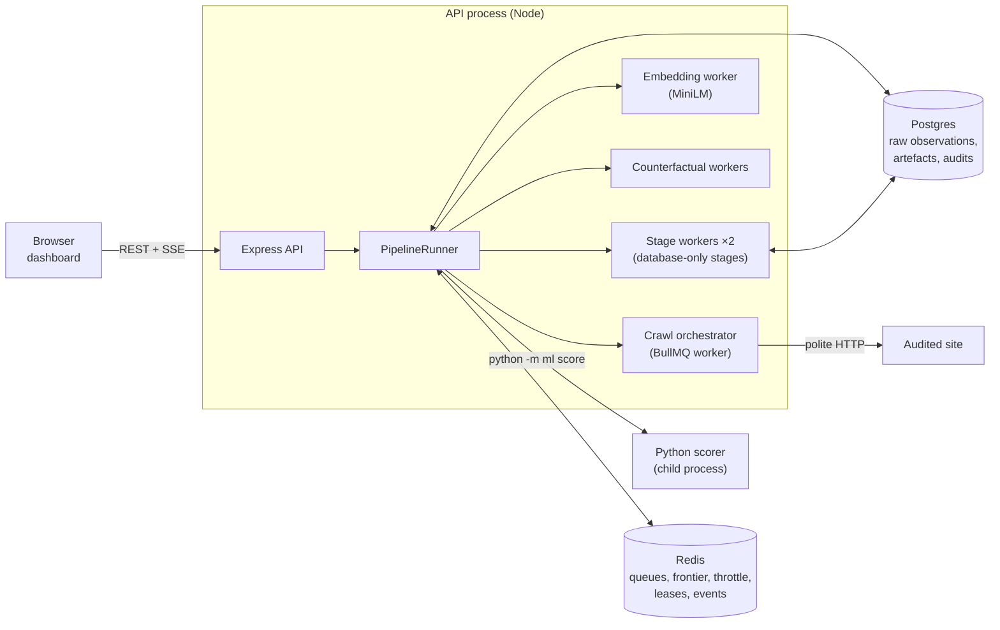
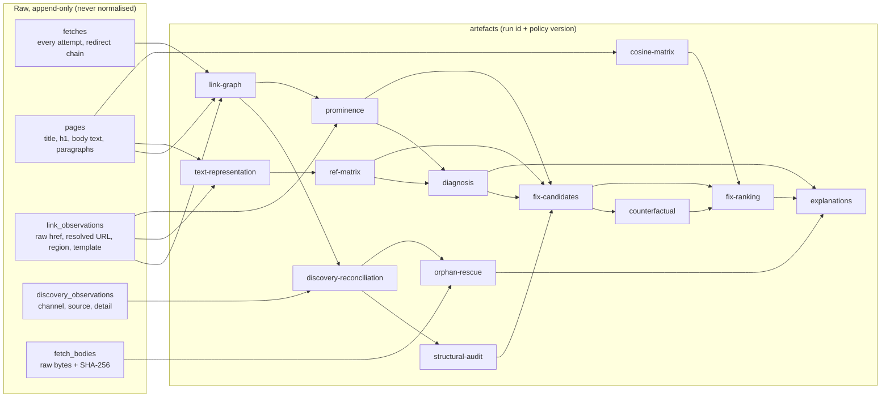

# Architecture

LinkLens audits a site's internal links. It crawls the site politely, stores what it observed
exactly as observed, and derives everything else (graphs, metrics, semantics, diagnoses and
ranked fixes) as versioned artefacts. This document shows how the pieces fit: the pipeline, what
each package is responsible for, and how data moves between them. The formal definitions are in
[METHODS.md](METHODS.md); the implementation spec is [CLAUDE.md](../CLAUDE.md).

## Two rules that shape everything

1. **Raw data is never normalised on write.** The crawler stores URLs, links and responses as it
   saw them. The link and discovery tables, raw bodies, analytics clicks and ratings are
   append-only; database triggers reject `UPDATE`, `DELETE` and `TRUNCATE`.
2. **Everything derived is an artefact.** A graph, a REF matrix or a fix ranking is a row in
   `artefacts` carrying its run id, the canonicalisation policy's version (`P3@1.0.0`), a kind and
   a JSON payload whose own version (`ref@1.2.0`) is bumped whenever the output can change. The
   same raw observations can therefore be re-derived under any of the six policies (P0–P5), and
   every number can be traced to the code and settings that produced it.

## The pipeline

An audit runs 21 stages in order. Each stage records its status, timings and a small detail in
`audit_stages`, so a failed or interrupted audit resumes at the first stage not completed.

```mermaid
flowchart TD
  subgraph Collect["Collect (network, polite)"]
    crawl["1 crawl<br/>robots.txt, per-host throttle,<br/>BFS frontier ≤ pageCap"]
    extract["2 extract<br/>links, regions, body text"]
    discovery["3 discovery<br/>sitemaps, robots Sitemap:,<br/>HTML sitemap, feeds, llms.txt"]
  end
  subgraph Structure["Structure (per policy P0–P5)"]
    canon["4 canonicalise"]
    lgraph["5 graph<br/>PageRank, depth, SCC, betweenness"]
    reconcile["6 reconcile<br/>channels → orphans"]
    issues["7 issues<br/>structural audit"]
  end
  subgraph Semantics
    txt["8 text<br/>field-aware TF-IDF"]
    ref["9 REF<br/>directional containment"]
    emb["10 embeddings<br/>MiniLM cosine"]
    prom["11 prominence<br/>ω from placement"]
    diag["12 diagnosis<br/>v1–v4"]
  end
  subgraph Fixes
    cand["13 candidates<br/>admissible donors"]
    cf["14 counterfactual<br/>ΔPR per simulated link"]
    kappa["15 κ<br/>editing effort"]
    scoring["16 scoring<br/>S = ΔPR × σ / κ"]
  end
  subgraph Optional["Optional model stages (skip without a model)"]
    imp["17 importance"]
    learned["18 learnedScore<br/>L13 ranker + SHAP"]
    gsage["19 graphsageScore"]
  end
  rescue["20 rescue<br/>donors for orphans"]
  expl["21 explanations<br/>deterministic templates"]

  crawl --> extract --> discovery --> canon --> lgraph --> reconcile --> issues
  issues --> txt --> ref --> emb --> prom --> diag --> cand --> cf --> kappa --> scoring
  scoring --> imp --> learned --> gsage --> rescue --> expl
```

The stages fall into five groups:

- **Collect.** The only stages that make requests to the audited site. Every request, each
  redirect hop included, is scope-checked, checked against robots.txt (RFC 9309) and spaced by
  the per-host throttle. Discovery and rescue have their own request caps and never count
  towards `pageCap`.
- **Structure.** Canonicalise URLs under the audit's policy, build the link graph and its
  metrics, reconcile the six discovery channels into an inventory (orphans are pages found
  outside the link graph), and apply the structural audit rules.
- **Semantics.** Build a field-aware TF-IDF text model, the directional containment matrix REF,
  page embeddings, the structural prominence ω of every link, and the four-case diagnosis.
- **Fixes.** Choose admissible donors for each target, simulate each candidate link on a copy of
  the graph, measure the donor's editing effort κ, and rank by S.
- **Optional models.** Page importance, the learned prioritiser (L13) and GraphSAGE, each toggled
  per audit. Without a trained model a stage completes as skipped, with the reason.

Rescue finds donors for orphans (pages nothing links to), and explanations turn every fix, rescue
and diagnosis into fixed-format sentences.

## Packages and responsibilities

| Package                   | Responsibility                                                                                                                                                                                                              | I/O                                                                                                                |
| ------------------------- | --------------------------------------------------------------------------------------------------------------------------------------------------------------------------------------------------------------------------- | ------------------------------------------------------------------------------------------------------------------ |
| `packages/core`           | Every algorithm: RFC 3986 URLs, the six canonicalisation policies, graph metrics, discovery reconciliation, the structural audit, text, REF, prominence, diagnosis, fixes, explanations. `config.ts` holds every threshold. | **None**. ESLint forbids `fs`, `http`, `pg`, `fetch` and `process`. Database helpers take an injected `Queryable`. |
| `packages/db`             | The `pg` pool and its `Queryable` adapter, SQL migrations (node-pg-migrate) and schema integration tests.                                                                                                                   | Postgres                                                                                                           |
| `packages/crawler`        | Fetching: robots.txt, the Redis-shared per-host throttle, the BullMQ crawl orchestrator and frontier, HTML extraction, discovery channels and the orphan rescue fetcher.                                                    | HTTP, Postgres, Redis                                                                                              |
| `packages/embeddings`     | Sentence embeddings (transformers.js, MiniLM) in a worker thread, with a content-addressed disk cache.                                                                                                                      | Model files, disk cache                                                                                            |
| `packages/counterfactual` | Runs core's fix simulation in parallel worker threads (and for orphan rescue).                                                                                                                                              | Worker threads, Postgres                                                                                           |
| `packages/api`            | The `PipelineRunner` (stages, leases, events, resume), the Express HTTP API with OpenAPI and SSE, the Python scorer bridge, and serving the built dashboard.                                                                | HTTP, Postgres, Redis, child processes                                                                             |
| `packages/web`            | The React + Vite dashboard: audits, live progress, graph, fixes, diagnosis, orphans, links, canonicalisation and rating.                                                                                                    | Browser, the API                                                                                                   |
| `packages/eval`           | Experiments E1–E8, the corpus runner and its reproducibility manifest, the L13 and GraphSAGE exports, and the LSH experiment.                                                                                               | Postgres, files                                                                                                    |
| `analysis/`               | Python statistics and figures for the experiments, and the ML models (`analysis/ml`: LightGBM ranker, GraphSAGE, `python -m ml score`). Not part of the pnpm workspace.                                                     | Files                                                                                                              |

## Runtime processes

- **Postgres** holds the raw observations (runs, fetches, pages, links, discovery observations,
  bodies, analytics clicks, ratings), the artefacts and the mutable audit bookkeeping (`audits`,
  `audit_stages`, `policy_jobs`).
- **Redis** holds what must be shared across processes: one BullMQ queue per run, the crawl
  frontier (a seen-set and an admitted counter updated by one Lua script), the per-host
  throttle, audit leases and the event channel that feeds server-sent events.
- **Several API instances** can serve one database. Each audit runs under a Redis lease in exactly
  one instance, and any instance can stream its events. An instance that stops gives its leases
  back, and on boot `recover()` resumes what a stopped instance left running.
- **Threads.** Database-only stages run in long-lived worker threads so the API stays
  responsive. Embeddings and counterfactual simulations have their own worker threads. The
  optional model stages start one Python process each.

## Data flow

- **Canonicalisation is a read-time projection.** A policy maps each raw URL to a node id when a
  graph is derived. P4 and P5 also read recorded redirects and `rel=canonical` observations. The
  raw rows never change, so switching policy re-derives, and the sensitivity table (E1) compares
  all six on one crawl.
- **Representative pages.** When a policy merges several fetched pages into one node, the earliest
  fetched is its representative. The graph, text model, prominence and κ all use that same page,
  so every artefact agrees on which page a node is.
- **Isolation of follow-up fetches.** Discovery and rescue fetches are stored with their own
  `purpose`. Graphs are built from `crawl` fetches only, so discovery and rescue never change a
  derived graph.
- **Recomputation on demand.** The API derives what is missing for another policy or σ variant
  from the stored raw data and artefacts, and stores it. For example, `/graph?policy=P5` or
  `/fixes?sigma=refOnly`.

## Reproducibility

- **Determinism.** Every random choice (betweenness sampling, E3 random baselines, E6 masking,
  MinHash, the rating sample, model training) draws from `config.randomSeed`. PageRank and every
  ordering use fixed tie-breaks, and explanations are byte-identical for identical evidence.
- **Configuration.** Each run stores its full resolved config. Per-audit overrides may only make
  crawling more polite: a longer delay or a smaller cap.
- **Versions.** Each policy, each stage's output and the embedding cache carry a version, bumped
  whenever output can change.
- **Corpus manifest.** A corpus batch records the git state, the config hash, every stage version,
  the embedding model's file hashes, the scoring models' hashes and the lockfile hash. It refuses
  to resume if any of them changed.
